# 🚀 Google Cloud Gemini Enterprise & Intelligent Agents


> **In Plain English:**  
> Imagine having an AI assistant that doesn't just search the public internet, but securely understands your company's **private files**, automatically schedules meetings on your **Google Calendar**, and talks directly to your **business database**—all through simple, everyday conversational English.

This repository documents the complete hands-on implementation of enterprise AI solutions built during the **Google Cloud Technical Series**.

---

## 🏆 Official Certification & Proof of Completion

Both hands-on labs were completed with a perfect score (**100/100**) to earn the official Google Cloud Credly Badge.

<p align="center">
  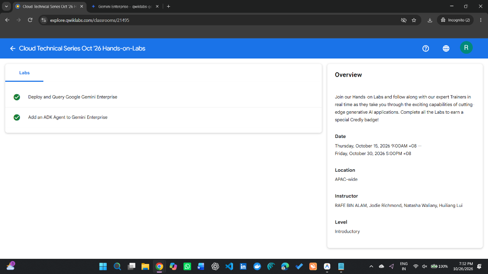
</p>

---

## 💡 What Did We Build? (At a Glance)

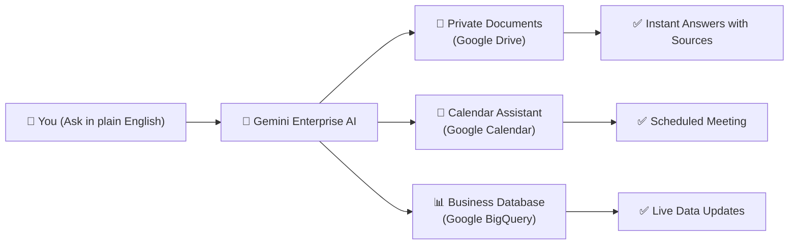

---

## 🔹 Part 1: Smart Company Search & Assistant (Lab 1)
> **Goal:** Connect private organizational documents and team calendar to an AI assistant.

### ❓ What problem does this solve?
In most companies, employees waste hours searching through folders, presentations, and reports to find answers. 
In this lab, we connected **Google Drive** directly to **Gemini Enterprise**. Now, any employee can ask questions in normal language and get verified answers with source links, or ask the AI to schedule a meeting with team members.

### 🛠️ What We Did (Step-by-Step):
1. **Added Company Knowledge:** Uploaded confidential research documents (`PlanetCon_Persephone.docx` and `Persephone_Analysis_Report.pdf`) to Google Drive.
2. **Connected Google Drive & Calendar:** Authorized secure enterprise connectors so the AI has permission to read internal files and create calendar invites.
3. **Tested the AI:**
   * **Question:** *"What is the size of Persephone compared to Earth?"*  
     👉 **AI Answer:** Accurately extracted the exact mass (0.92x) and radius (0.97x) from our uploaded report and provided the citation link.
   * **Action:** *"Create a 1-hour meeting tomorrow at 10am for the research team to review proposals."*  
     👉 **AI Action:** Drafted the event, asked for confirmation, and placed it directly into Google Calendar.

### 📸 Visual Evidence (Part 1):
| 1. Company Files in Google Drive | 2. Gemini Enterprise Web Application |
|:---:|:---:|
| 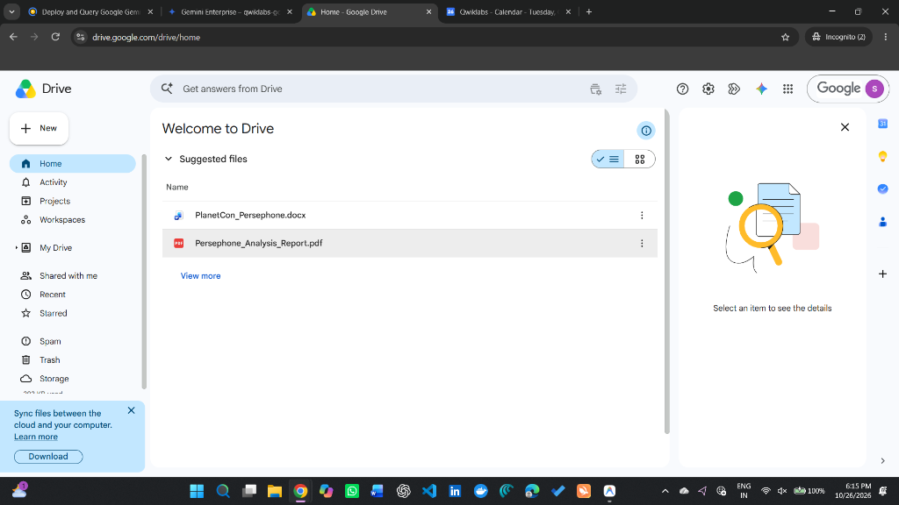 | 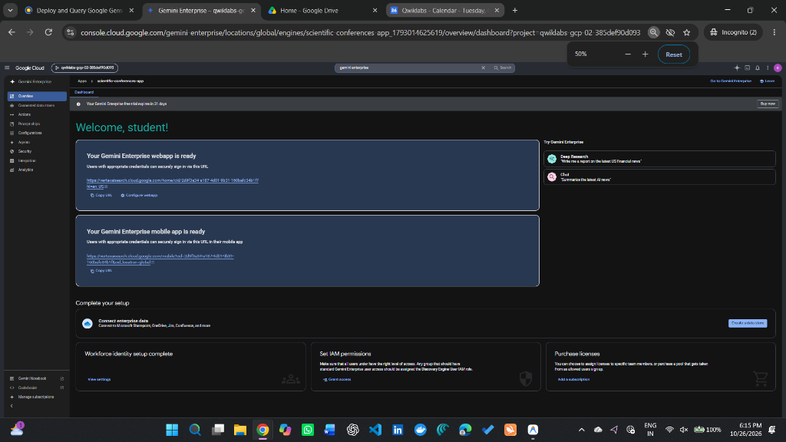 |

| 3. AI Confirms Meeting Creation | 4. Real Event Created on Google Calendar |
|:---:|:---:|
| 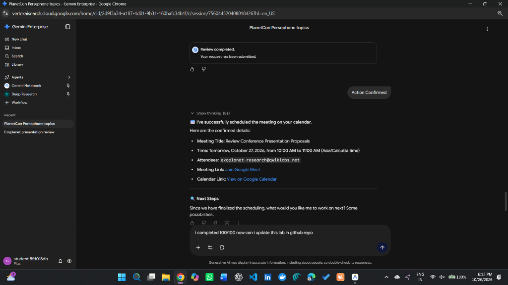 | 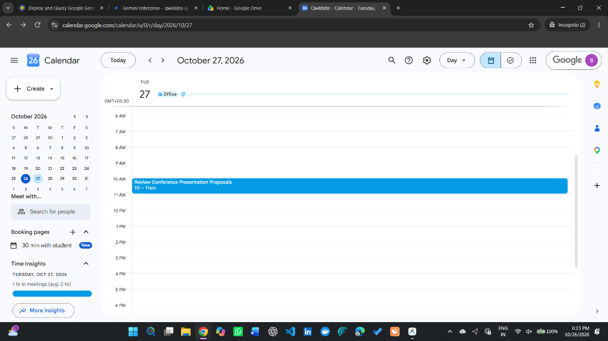 |

| 5. Verified Perfect Score (100 / 100) |
|:---:|
| 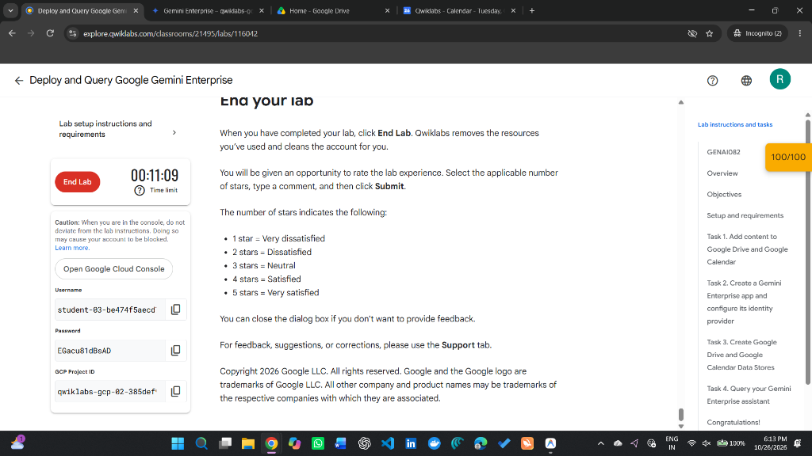 |

---

## 🔹 Part 2: Talking to Databases in Plain English (Lab 2)
> **Goal:** Build an autonomous custom AI agent that can query and insert real customer data into a database without writing code.

### ❓ What problem does this solve?
Normally, querying a database requires writing complex SQL code (`SELECT * FROM table WHERE...`). Non-technical team members (like sales or support staff) usually have to ask software engineers for help.
In this lab, we built a custom AI agent using Google's **Agent Development Kit (ADK)** that acts as a bridge: anyone can type a request like *"What is our average pool size?"* or *"Record a new pool request"*, and the AI handles the database operations behind the scenes.

### 🛠️ What We Did (Step-by-Step):
1. **Created the AI Agent Code:** Used Python and Google's Agent Development Kit (`google-adk`) to give the agent database reading and writing permissions.
2. **Deployed to the Cloud:** Published the agent to **Vertex AI Agent Engine** (Google Cloud's managed runtime for intelligent agents).
3. **Secured with OAuth 2.0:** Created authentication credentials so only authorized employees can use the agent.
4. **Tested Live Data Operations:**
   * Asked the agent to calculate statistics from historical pool installation requests.
   * Dictated a brand-new customer request in plain English (20m length, 10m width, includes hot tub, customer phone and email).
   * The agent automatically inserted the row into BigQuery and displayed the verified entry!

### 📸 Visual Evidence (Part 2):
| 1. Enterprise Agent Connected & Authenticated | 2. AI Inserts & Retrieves Database Entry |
|:---:|:---:|
| 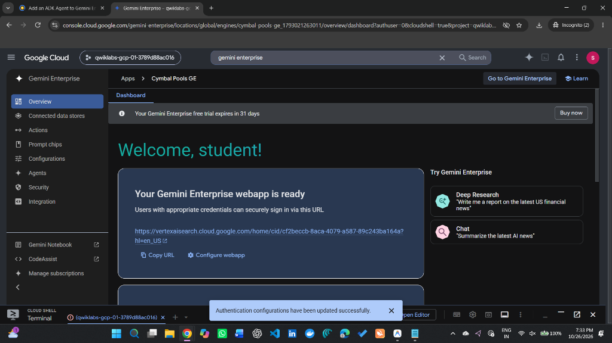 | 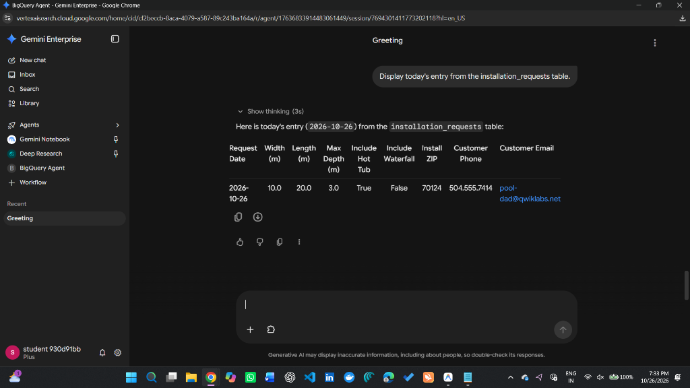 |

| 3. Code Package Downloaded from Cloud Shell | 4. Verified Perfect Score (100 / 100) |
|:---:|:---:|
| 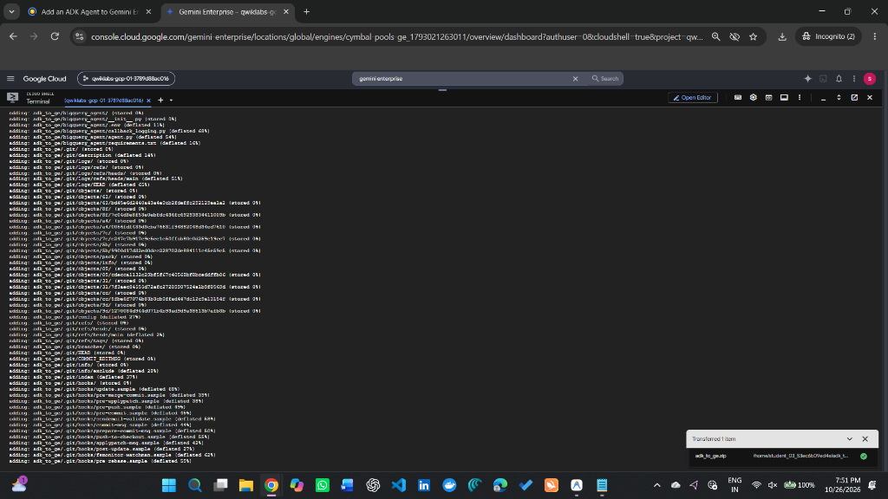 | 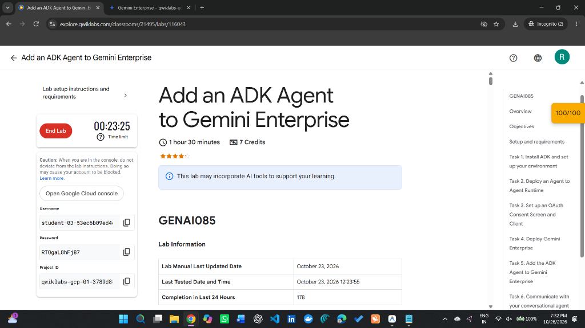 |

---

## 📂 Project Directory Structure

```text
google-cloud-gemini-enterprise-series/
├── README.md                          # You are here (project overview & guide)
├── construct_auth_uri.py              # Script that creates secure sign-in links
├── requirements.txt                   # List of required software libraries
├── .gitignore                         # Prevents private keys from being exposed
├── bigquery_agent/                    # Custom AI agent code
│   ├── agent.py                       # Defines how the agent thinks and acts
│   ├── .env.example                   # Configuration template for cloud settings
│   ├── callback_logging.py            # Records events and activity
│   ├── requirements.txt               # Agent-specific libraries
│   └── __init__.py                    # Python package initializer
└── screenshots/                       # Complete visual evidence
    ├── 00_both_labs_completed_badge.png
    ├── lab1/                          # All Lab 1 proof images
    └── lab2/                          # All Lab 2 proof images
```

---

## 🌟 Key Takeaways
* **Grounded Search (RAG):** AI responses are factual and backed by real documents rather than guessing.
* **Autonomous Actions:** The AI can take real-world actions (like sending meeting invites) with human-in-the-loop approval.
* **Democratizing Data Access:** Anyone can interact with complex enterprise databases (BigQuery) using conversational English.

---

## 👤 Author
* **Ranjith B**
* GitHub: [@ranjithbrs](https://github.com/ranjithbrs)
